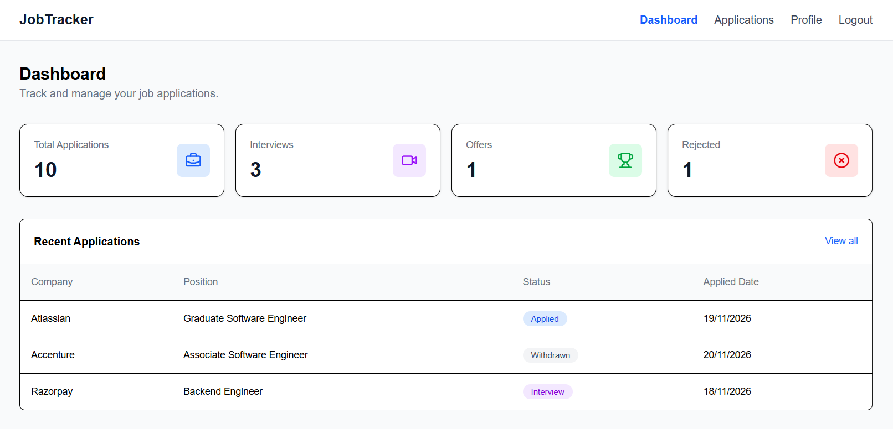
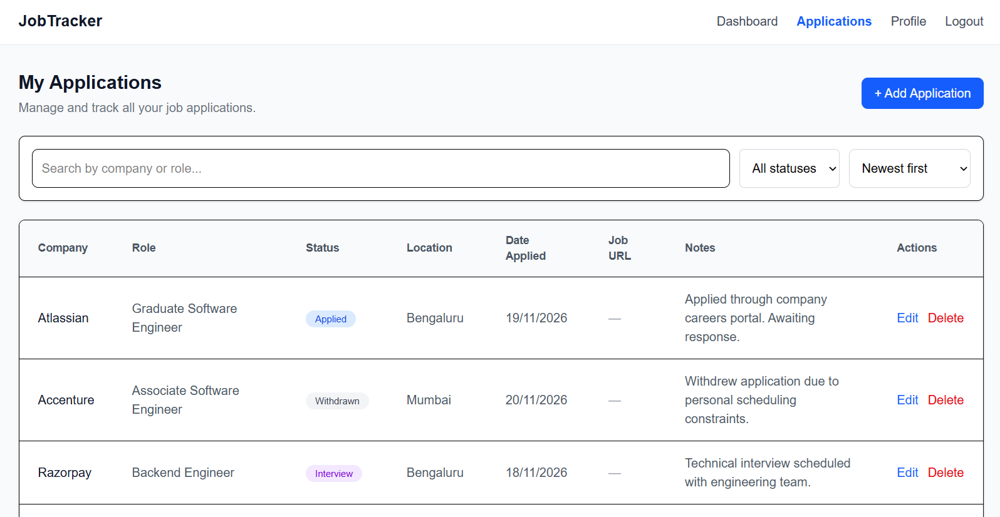

# Job Tracker

A full-stack web app for tracking job applications from "saved" to "offer". Built end to end with React, Express, TypeScript and PostgreSQL, and deployed on free-tier cloud services.

**Live demo:** https://job-tracker-frontend-nine-omega.vercel.app

**Demo login:** `jobtracker.demo@example.com` / `JobTrackerDemo#2026`

> The backend runs as a serverless function and the database scales to zero when idle, so the first request after a quiet period can take a few seconds. After that it responds normally.

## Screenshots

### Dashboard



### Applications



## Features

- Register, log in and stay signed in across page refreshes (JWT, session restored on load)
- Add, edit, view and delete applications with six statuses: saved, applied, interview, offer, rejected, withdrawn
- Search, filter by status, sort and paginate the application list
- Dashboard with total and per-status counts
- Profile page, protected routes and a responsive layout
- Every user sees only their own data

## Tech stack

| Layer             | Technology                                                 |
| ----------------- | ---------------------------------------------------------- |
| Frontend          | React 19, Vite, TypeScript, React Router, Tailwind CSS     |
| Backend           | Node.js, Express 5, TypeScript                             |
| Database          | PostgreSQL (Neon) with the `pg` driver                     |
| Validation        | Zod                                                        |
| Auth and security | bcrypt, JSON Web Tokens, Helmet, CORS, login rate limiting |
| Hosting           | Vercel (frontend and backend as separate projects), Neon   |

## Architecture

React + Vite (Vercel)
|
| HTTP requests
v
Express API (Vercel Serverless Functions)
|
| SQL queries
v
PostgreSQL (Neon)

The backend follows a layered architecture:

Routes -> Controllers -> Services -> Database

Routes handle endpoint definitions and middleware, controllers handle HTTP requests and responses, and services contain the application logic and database operations.

Zod validates incoming request bodies and query parameters before processing.

## API overview

| Method | Endpoint              | Description                                         |
| ------ | --------------------- | --------------------------------------------------- |
| POST   | `/auth/register`      | Create an account                                   |
| POST   | `/auth/login`         | Log in and receive a JWT                            |
| GET    | `/auth/me`            | Current user (requires token)                       |
| GET    | `/applications`       | List with pagination, filtering, search and sorting |
| GET    | `/applications/stats` | Totals and per-status counts                        |
| GET    | `/applications/:id`   | Single application                                  |
| POST   | `/applications`       | Create                                              |
| PATCH  | `/applications/:id`   | Partial update                                      |
| DELETE | `/applications/:id`   | Delete                                              |

All `/applications` routes require an `Authorization: Bearer <token>` header.

## Design decisions

- **Postgres over a document store.** The data is relational (users -> applications), so I used foreign keys with `ON DELETE CASCADE`, a `CHECK` constraint on status, and a composite index on `(user_id, created_at DESC)` for the list query.
- **Authorization at the query level.** Every application query filters on the authenticated user's id, so one user can never read or change another user's rows.
- **Safe queries.** All SQL is parameterized, and sortable columns come from a whitelist.
- **Password handling.** Passwords are hashed with bcrypt, and inputs are checked against bcrypt's 72-byte limit.

## Running locally

Requirements: Node.js 20+ and PostgreSQL.

```bash
git clone https://github.com/HITESH1603/job-tracker.git
cd job-tracker
```

**Database**

```bash
createdb job_tracker
psql job_tracker -f backend/sql/schema.sql
```

**Backend**

```bash
cd backend
cp .env.example .env   # fill in your database details and a random JWT_SECRET
npm install
npm run dev            # http://localhost:3000
```

**Frontend**

```bash
cd frontend
cp .env.example .env
npm install
npm run dev            # http://localhost:5173
```

## Deployment

- **Database:** Neon (free plan). Run `backend/sql/schema.sql` once against it.
- **Backend:** Vercel project with root directory `backend`. Environment variables: `DATABASE_URL` (Neon pooled connection string), `JWT_SECRET`, `FRONTEND_URL` (the frontend's origin, no trailing slash). When `DATABASE_URL` is set, the `DB_*` variables are ignored.
- **Frontend:** Vercel project with root directory `frontend`. Environment variable: `VITE_API_URL` (the backend's URL, no trailing slash). `vercel.json` rewrites all routes to `index.html` so React Router deep links work.

## Known limitations and next steps

- The login rate limiter uses in-memory storage, which is per-instance on serverless. A shared store such as Redis would be the production choice.
- The JWT is kept in session storage. An httpOnly cookie would reduce XSS exposure.
- Planned: automated tests with CI, and an AI-assisted job-description parser that pre-fills the application form.

Author: Hitesh Mahato

GitHub: https://github.com/HITESH1603
